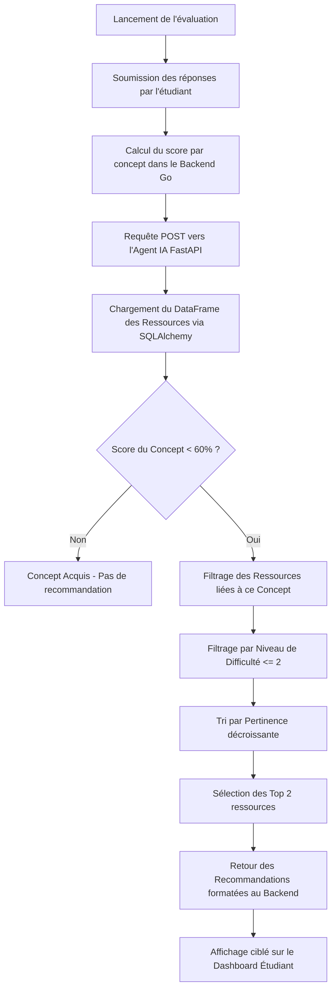

# Architecture et Fonctionnement de l'Agent IA de Recommandation Pédagogique

Ce document présente le fonctionnement technique, les choix technologiques et les bases algorithmiques de l'**Agent IA** conçu pour le système de recommandation de l'Université Numérique Cheikh Hamidou Kane (UNCHK).

---

## 1. Introduction et Objectif
L'objectif principal de cet Agent IA est de pallier les difficultés d'apprentissage des étudiants en leur fournissant des recommandations personnalisées et immédiates après une évaluation. 
L'agent analyse les résultats des tests de niveau d'un étudiant, identifie les lacunes par concept (matière/compétence) et sélectionne les ressources pédagogiques (vidéos, PDF, exercices interactifs) les plus pertinentes pour l'aider à s'améliorer.

---

## 2. Pile Technologique & Bibliothèques Utilisées

L'agent est implémenté en Python et repose sur un ensemble de bibliothèques performantes et standardisées :

| Bibliothèque | Rôle et Usage dans l'Agent |
| :--- | :--- |
| **FastAPI** | Framework moderne et ultra-rapide pour construire des API web. Il reçoit les requêtes de recommandation du serveur backend principal Go (Gin) de façon asynchrone. |
| **Uvicorn** | Serveur web ASGI asynchrone utilisé pour faire tourner l'application FastAPI en production. |
| **Pandas** | Bibliothèque de manipulation et d'analyse de données. Elle permet de structurer les ressources pédagogiques sous forme de tableaux bidimensionnels (DataFrames) pour appliquer des filtres complexes rapidement. |
| **SQLAlchemy** | ORM (Object-Relational Mapper) utilisé pour se connecter à la base de données PostgreSQL de l'UNCHK et lire efficacement le catalogue de ressources. |
| **Numpy** | Utilisé pour le support des calculs matriciels et mathématiques sous-jacents lors du filtrage et du tri. |

---

## 3. Algorithme d'Analyse et de Génération des Recommandations

L'algorithme de recommandation repose sur un système de **filtrage basé sur le contenu (Content-Based Filtering)** guidé par des règles d'acquisition académiques.

### Diagramme de flux de la recommandation

### Détail des étapes de l'algorithme :
1. **Identification des Lacunes (Seuil de Maîtrise)** :
   L'agent parcourt les scores obtenus par l'étudiant pour chaque concept évalué (ex: UML, POO, SQL, Agile). Un concept est identifié comme une **lacune** si le score est strictement inférieur à **60%** (seuil de validation académique standard).
2. **Filtrage Thématique** :
   Pour chaque lacune détectée, l'agent extrait du catalogue de ressources uniquement celles qui correspondent au concept concerné.
3. **Filtrage Adaptatif de Niveau** :
   Pour combler les lacunes fondamentales, l'agent filtre et sélectionne uniquement les ressources de niveau débutant à intermédiaire (`niveau_difficulte <= 2`) afin de ne pas décourager l'étudiant avec des ressources trop avancées.
4. **Optimisation par Tri de Pertinence** :
   Les ressources filtrées sont triées par leur score de pertinence attribué par les enseignants (de 1 à 5 étoiles). Les **2 meilleures ressources** ayant la pertinence maximale sont conservées.

---

## 4. Pourquoi cette approche ? Comparaison avec d'autres Modèles

Dans la recherche sur les systèmes de recommandation, trois grandes familles de modèles coexistent. Voici une comparaison mettant en lumière le choix de notre architecture pour l'UNCHK :

### Tableau Comparatif des Modèles

| Modèle de Recommandation | Avantages | Inconvénients / Limites | Pertinence pour le contexte UNCHK |
| :--- | :--- | :--- | :--- |
| **Filtrage Collaboratif** *(Collaborative Filtering)* | Découvre des relations complexes basées sur le comportement de groupes d'utilisateurs similaires. | Souffre du problème de **démarrage à froid (Cold Start)** : incapable de recommander pour un nouvel étudiant ou une nouvelle ressource sans historique. | **Inadapté** au départ, car chaque nouvel étudiant a besoin de recommandations immédiates dès son premier test de niveau. |
| **Systèmes basés sur le Deep Learning / LLMs** *(RAG, Embeddings vectoriels)* | Compréhension sémantique très riche des documents et des questions. | Coûteux en ressources de calcul (GPU), lent, comporte des risques d'hallucinations et manque d'explicabilité stricte. | **Surdimensionné et peu transparent** pour une intégration directe avec le modèle pédagogique strict de l'université. |
| **Filtrage Basé sur le Contenu et les Règles Métier** *(Notre modèle)* | **Pas de problème de démarrage à froid**. Totalement prédictif et explicable. Consomme très peu de ressources de calcul. | Repose sur l'étiquetage correct des ressources par les enseignants (concept, niveau, pertinence). | **Idéal et robuste**. Garantit qu'un étudiant ayant échoué en "UML" recevra exactement des ressources d'UML adaptées, validées par ses enseignants. |

### Les Avantages Majeurs de notre Solution pour l'UNCHK :
* **Explicabilité Pédagogique** : L'agent fournit une explication textuelle claire à l'étudiant (ex: *"Ressource recommandée car votre score en UML est de 40%"*), ce qui renforce sa confiance et son autonomie.
* **Sobriété et Vitesse** : Grâce à l'utilisation conjointe de FastAPI et de Pandas, le temps de réponse de l'agent est inférieur à 10 millisecondes, garantissant une expérience fluide sur la plateforme.
* **Contrôle Académique** : Ce sont les enseignants de l'UNCHK qui gardent le contrôle du catalogue en définissant et ajoutant de nouveaux concepts (comme implémenté récemment) et en évaluant la pertinence des ressources.
